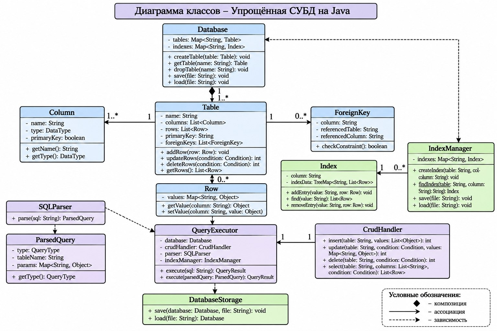
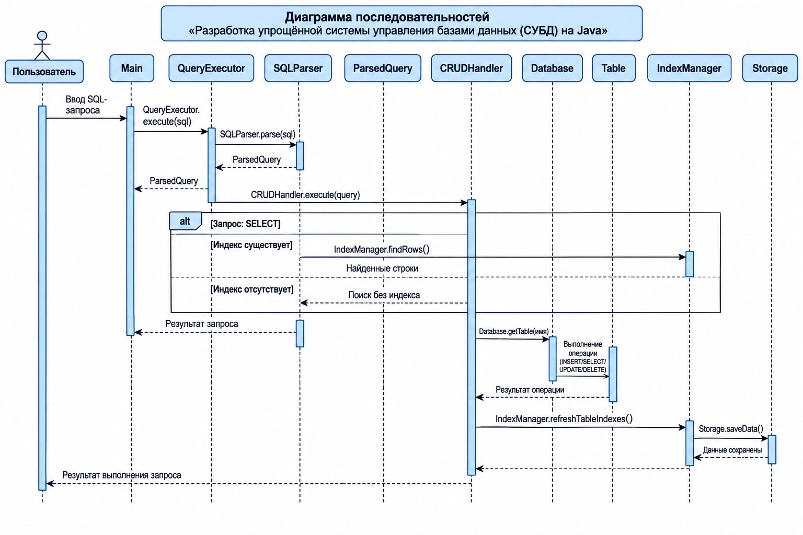

# Лабораторная работа №2

## Разработка упрощённой системы управления базами данных (СУБД) на Java

### Авторы

Сосновских Татьяна,
Капина Анна,
Ершова Екатерина
(25КНТ-5)

---

# Описание проекта

Проект представляет собой упрощённую систему управления базами данных (СУБД), реализованную на языке Java. Программа поддерживает создание и хранение таблиц, выполнение SQL-подобных запросов, сериализацию данных на диск, работу с индексами и проверку ограничений целостности.

Предметная область демонстрационного примера — хранение информации о товарах и категориях.

Используются две связанные таблицы:

- categories — категории товаров;
- goods — товары.

Связь между таблицами реализована посредством внешнего ключа:

goods.categoryId → categories.id
---

# Возможности программы

Реализованы следующие функции:

- создание базы данных;
- создание таблиц;
- добавление записей;
- изменение записей;
- удаление записей;
- выборка данных;
- вывод результатов в виде таблицы;
- проверка уникальности первичного ключа;
- проверка ограничений внешнего ключа;
- сериализация базы данных;
- загрузка базы данных при запуске;
- SQL-подобный парсер запросов;
- создание индексов;
- сохранение и восстановление индексов;
- использование индексов при выполнении SELECT-запросов.

---

# Поддерживаемые типы данных

В проекте реализованы следующие типы данных:

- INTEGER
- DOUBLE
- STRING
- DATE
- BOOLEAN

---

# Поддерживаемые SQL-запросы

Программа поддерживает следующие команды.

## INSERT

```sql
INSERT INTO goods VALUES (1, 1, 'Apple', 100.0);
```

```sql
INSERT INTO goods (id, name) VALUES (2, 'Banana');
```
---

## SELECT

```sql
SELECT * FROM goods;
```

```sql
SELECT name, price FROM goods;
```

```sql
SELECT name, price FROM goods WHERE price > 100;
```
---

## UPDATE

```sql
UPDATE goods
SET price = 120
WHERE id = 1;
```
---

## DELETE

```sql
DELETE FROM goods
WHERE id = 1;
```
---

## CREATE TABLE

```sql
CREATE TABLE shops (
    id INTEGER PRIMARY KEY,
    name STRING
);
```
---

## DROP TABLE

```sql
DROP TABLE shops;
```
---

## CREATE INDEX

```sql
CREATE INDEX idx_goods_name
ON goods (name);
```
---

# Структура проекта
```text
Java-DBMS/
├── diagrams/
│   ├── class-diagram.png
│   └── sequence-diagram.png
├── docs/
│   ├── database/
│   ├── legal/
│   ├── resource-files/
│   ├── script-files/
│   ├── storage/
│   ├── allclasses-index.html
│   ├── allpackages-index.html
│   ├── element-list
│   ├── help-doc.html
│   ├── index-all.html
│   ├── index.html
│   ├── Main.html
│   ├── member-search-index.js
│   ├── module-search-index.js
│   ├── overview-summary.html
│   ├── overview-tree.html
│   ├── package-search-index.js
│   ├── package-summary.html
│   ├── package-tree.html
│   ├── search.html
│   ├── serialized-form.html
│   ├── tag-search-index.js
│   └── type-search-index.js
├── src/
│   ├── database/
│   │   ├── Column.java
│   │   ├── DataType.java
│   │   ├── Database.java
│   │   ├── ForeignKey.java
│   │   ├── Row.java
│   │   └── Table.java
│   ├── executor/
│   │   ├── CrudHandler.java
│   │   └── QueryExecutor.java
│   ├── index/
│   │   ├── Index.java
│   │   └── IndexManager.java
│   ├── parser/
│   │   ├── ParsedQuery.java
│   │   └── SQLParser.java
│   ├── storage/
│   │   └── DatabaseStorage.java
│   ├── CrudTest.java
│   ├── IndexPerformanceTest.java
│   ├── IndexTest.java
│   ├── ParserTest.java
│   └── Main.java
├── .gitignore
├── checkstyle.xml
└── README.md
```
---

# Архитектура системы

Проект построен с использованием объектно-ориентированного подхода.

Основные компоненты:

- **Database** — хранение всех таблиц;
- **Table** — описание таблицы;
- **Row** — отдельная запись;
- **Column** — описание столбца;
- **ForeignKey** — описание внешнего ключа;
- **SQLParser** — разбор SQL-запросов;
- **ParsedQuery** — структура разобранного запроса;
- **QueryExecutor** — выполнение запросов;
- **CrudHandler** — реализация CRUD-операций;
- **Index** — структура индекса;
- **IndexManager** — создание, сохранение и использование индексов;
- **DatabaseStorage** — сериализация базы данных.

---

# Диаграмма классов



---

# Диаграмма последовательности



---

# Результаты тестирования

В проекте реализованы автоматические тесты.

## ParserTest

Проверяет:

- INSERT;
- SELECT;
- UPDATE;
- DELETE;
- CREATE TABLE;
- DROP TABLE;
- CREATE INDEX.

Результат:
9 успешно
0 ошибок
---

## IndexTest

Проверяет:

- создание индексов;
- поиск по индексу;
- сравнение операторов;
- обновление индексов;
- сохранение индексов;
- загрузку индексов.

Результат:
```text
8 успешно
0 ошибок
```
---

# Сравнение производительности

Проводилось сравнение выполнения запросов с использованием индекса и без него.

Без индекса поиск выполняется последовательным просмотром всех записей таблицы.

При наличии индекса поиск осуществляется по индексной структуре, что значительно сокращает количество проверяемых записей.

Для небольших таблиц разница практически незаметна, однако при увеличении объёма данных использование индексов обеспечивает более высокую скорость выполнения SELECT-запросов.

```text
Без индекса: 31 ms
С индексом: 5 ms
Ускорение: примерно в 6 раз
```

---

# Инструкция пользователя

## Компиляция

```bash
javac -encoding UTF-8 -d out (Get-ChildItem src -Recurse -Filter *.java | ForEach-Object FullName)
```
## Запуск программы
```bash
java -cp out Main
```
## Запуск тестов
```bash
java -cp out ParserTest
```
```bash
java -cp out IndexTest
```

---

# Пример работы программы

При запуске демонстрируются:

- создание базы данных;
- добавление категории;
- добавление товара;
- выборка данных;
- изменение записи;
- удаление записи;
- проверка внешнего ключа;
- сохранение базы данных.

---

# Распределение обязанностей

### Сосновских Татьяна

- разработка структуры базы данных;
- сериализация базы данных;
- реализация CRUD-операций;
- внешние ключи;
- демонстрационная программа (Main).

### Ершова Екатерина

- разработка SQL-парсера;
- реализация CREATE TABLE и DROP TABLE;
- создание системы индексов;
- оптимизация SELECT;
- тестирование парсера;
- тестирование индексов.

### Капина Анна

- интеграция компонентов проекта;
- объединение изменений;
- исправление ошибок после слияния;
- финальное тестирование проекта;
- подготовка итоговой версии.

---

# Использованные технологии

- Java 8+
- Сериализация объектов
- Коллекции Java
- Регулярные выражения
- Обработка SQL-подобных запросов
- Индексирование данных
- Объектно-ориентированное программирование

---

# Выводы

В ходе выполнения лабораторной работы была разработана упрощённая система управления базами данных, поддерживающая основные операции работы с таблицами и записями.

Реализованы:

- хранение данных;
- сериализация;
- SQL-парсер;
- индексация;
- проверка ограничений целостности;
- автоматическое тестирование.

Все основные требования лабораторной работы выполнены.

---

# Список использованных источников

1. Oracle. *Java Platform SE Documentation*. https://docs.oracle.com/javase/
2. Joshua Bloch. *Effective Java*. Addison-Wesley.
3. Bruce Eckel. *Thinking in Java*.
4. Martin Fowler. *Patterns of Enterprise Application Architecture*.
5. Gamma E., Helm R., Johnson R., Vlissides J. *Design Patterns: Elements of Reusable Object-Oriented Software*.